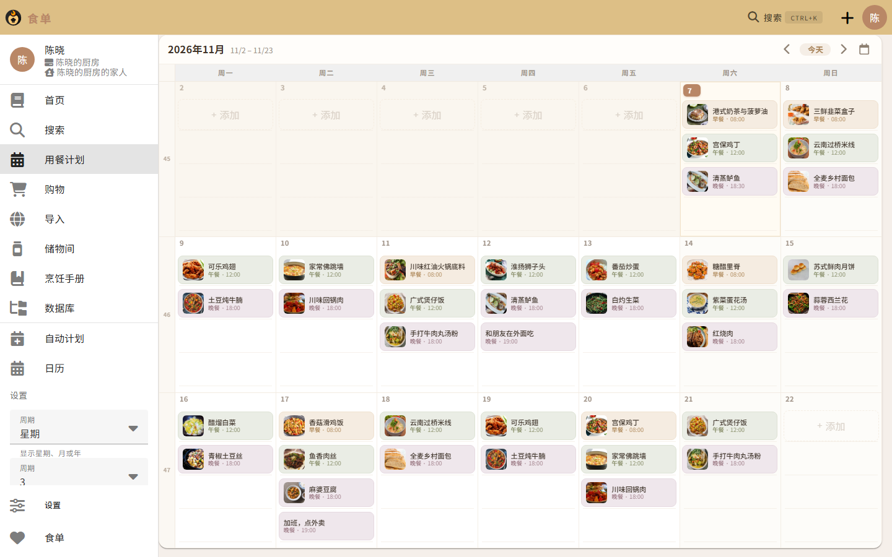

# 食单 · Dishbook

一个**中文优先**的菜谱与用餐计划应用，可以管理菜谱、安排一周三餐、自动汇总购物清单，并支持多人协作。

本项目基于开源项目 [Tandoor Recipes](https://github.com/TandoorRecipes/recipes) 二次开发：后端沿用其 Django 数据模型与 API，前端做了完整的本地化与界面重做。**不是从零开始的产品**，改动范围见下文。



## 相对上游做了什么

| 方向 | 具体改动 | 关键文件 |
|---|---|---|
| 中文化 | 1120 个界面文案全部译为简体中文；默认语言锁定中文，不再跟随浏览器 `Accept-Language` | `vue3/src/locales/zh_Hans.json`、`cookbook/helper/locale_default.py` |
| 品牌 | 更名「食单 / Dishbook」，登录页、顶栏、页面标题、PWA 名称、邀请邮件统一替换；字标拆成「图标 + 文本」以便换名 | `vue3/src/components/display/BrandWordmark.vue`、`cookbook/theming_tags.py` |
| 会话策略 | 双规则：页面常开满 3 小时弹窗强制下线；页面关闭后 5 分钟未回来则过期。心跳续期 + 响应头下发剩余时间 | `cookbook/helper/session_limits.py`、`vue3/src/utils/sessionGuard.ts` |
| 用餐计划 | 日历重做：行高由当天条目数反推（不再溢出到下一周）、条目按餐次配色、空白格给「＋ 添加」占位、工具条改为「‹ 今天 › + 日历」 | `vue3/src/components/display/MealPlanView.vue` |
| 手机布局 | 小于 960px 不再渲染七列网格，改为按天分组的议程列表 | `vue3/src/components/display/MealPlanAgenda.vue` |
| 深色模式 | 日历与条目改用 CSS 变量，深色主题下不再出现白色板块 | `MealPlanView.vue` 的 `--mp-*` token |
| 工程化 | 抽出日历布局纯函数并补 17 个单测；补齐运维脚本；修正 28 条失败用例中的 4 条、其余标注原因 | `vue3/src/utils/mealplanLayout.ts`、`scripts/`、`docs/KNOWN_ISSUES.md` |
| 文档 | 使用手册（单文件 HTML，可直接打印）、已知问题清单 | `docs/食单使用手册.html`、`docs/KNOWN_ISSUES.md` |

## 技术栈

- 后端：Python 3.12 · Django 5.2 · Django REST Framework · django-allauth（headless 模式）· django-scopes（多空间隔离）
- 前端：Vue 3.5 · Vite 8 · Vuetify 3 · Pinia · vue-router · vue-i18n · vue-simple-calendar
- 数据：SQLite（开发）/ PostgreSQL（生产）· 图片存本地或 S3
- 测试：pytest（后端 1266 通过）· vitest（前端布局逻辑）

## 本地运行

```bash
# 1. 依赖
python -m venv .venv
.venv/Scripts/activate          # macOS / Linux: source .venv/bin/activate
pip install -r requirements.txt
cd vue3 && npm install && cd ..

# 2. 配置：参考 .env.template，至少需要 SECRET_KEY、DEBUG、ALLOWED_HOSTS
#    本仓库的 .env 里有可直接跑起来的本地配置（已被 git 忽略）

# 3. 数据库 + 前端构建
python manage.py migrate
bash scripts/build_frontend.sh  # 构建前端并同步到 staticfiles/

# 4. 启动
python manage.py runserver 127.0.0.1:8000
```

打开 http://127.0.0.1:8000 即可。演示账号：`chenxiao@example.com` / `Tandoor@2026`（普通用户），`admin@example.com` / `Tandoor@2026`（超级管理员）。

> **改了前端却没生效？** `vite build` 之后必须重跑 `scripts/sync_static.py` **并重启 Django 进程**。原因有两个，都写进了脚本注释：whitenoise 在启动时缓存文件索引；`ManifestStaticFilesStorage` 会把 `manifest.json` 映射到一份冻结的 `manifest.<hash>.json` 副本。
>
> 想边改边看，用 `cd vue3 && npm run dev`（HMR），后端需要以开发模式启动（见 `vue3/vite.config.ts`）。

### 灌入演示数据

```bash
python scripts/reset_demo_data.py   # 清空内容并创建普通账号（保留用户与空间）
python scripts/seed_demo_data.py    # 30 道菜谱、4 个食谱本、35 条用餐计划、2 张购物清单
python scripts/seed_demo_images.py  # 为每道菜配图（来自 TheMealDB，压缩后写入 mediafiles/）
```

## 测试

```bash
# 后端：1266 passed, 18 skipped, 19 xfailed（预期失败的用例都带原因，见 docs/KNOWN_ISSUES.md）
.venv/Scripts/python.exe -m pytest cookbook/tests -q -n 4 --no-cov

# 前端：日历布局的槽位计算、行高推导、可见区间
cd vue3 && npm run test

# 中英文语言包键对齐
python scripts/check_i18n_keys.py --strict
```

`xfail` 不是隐藏失败：这些用例仍会执行，一旦修好会以 `XPASS` 出现在报告里，提醒把标记摘掉。

## 目录

```
cookbook/           Django 应用（模型、API、视图、测试）
  helper/           会话、语言、图片等横向能力
  tests/            1270+ 用例
recipes/            项目配置（settings / urls / wsgi）
vue3/src/           Vue 前端
  components/display/  日历、条目、议程、品牌字标
  utils/mealplanLayout.ts  日历几何纯函数（有单测）
  locales/          语言包（zh_Hans / en 必须键对齐）
scripts/            构建、同步、灌数据、截图、i18n 校验
docs/               MkDocs 文档、使用手册、已知问题、截图
```

常用脚本：

| 脚本 | 用途 |
|---|---|
| `scripts/build_frontend.sh` | 构建前端 + 同步静态文件（改完前端必须跑） |
| `scripts/sync_static.py` | 只做同步，含刷新冻结的 manifest 副本 |
| `scripts/reset_demo_data.py` | 清空内容、重建演示账号 |
| `scripts/seed_demo_data.py` | 灌入 30 道菜谱与两周计划 |
| `scripts/capture_screenshots.mjs` | 用 CDP 重采 `docs/screenshots/` 截图 |
| `scripts/check_i18n_keys.py` | 中英文键对齐检查 |

## 已知问题

见 [docs/KNOWN_ISSUES.md](docs/KNOWN_ISSUES.md)：19 条预期失败用例（上游遗留居多，均附真实报错）、API 匿名访问返回码不一致、`vue-tsc` 与 TypeScript 7 不兼容等。

## 许可证与署名

本项目继承上游的 **GPLv3 + Commons Clause** 许可，详见 [LICENSE.md](LICENSE.md)。原始版权归 Tandoor Recipes 及其贡献者所有；本仓库的改动与来源说明见 [NOTICE.md](NOTICE.md)。

Commons Clause 限制的是「销售本软件」，自建使用、修改、分发（保留许可与声明）不受影响。
