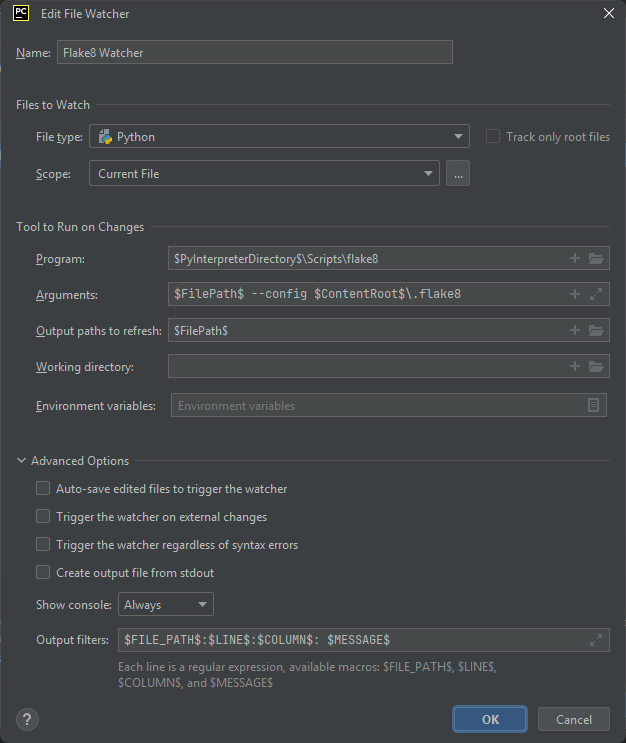
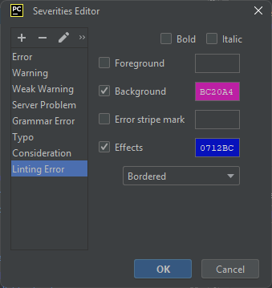
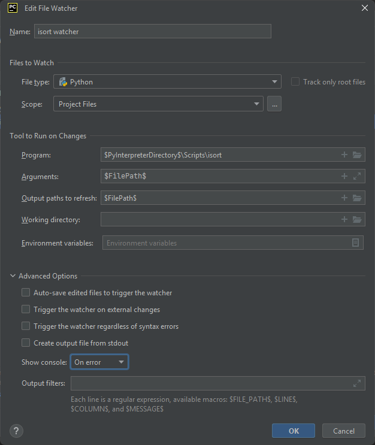
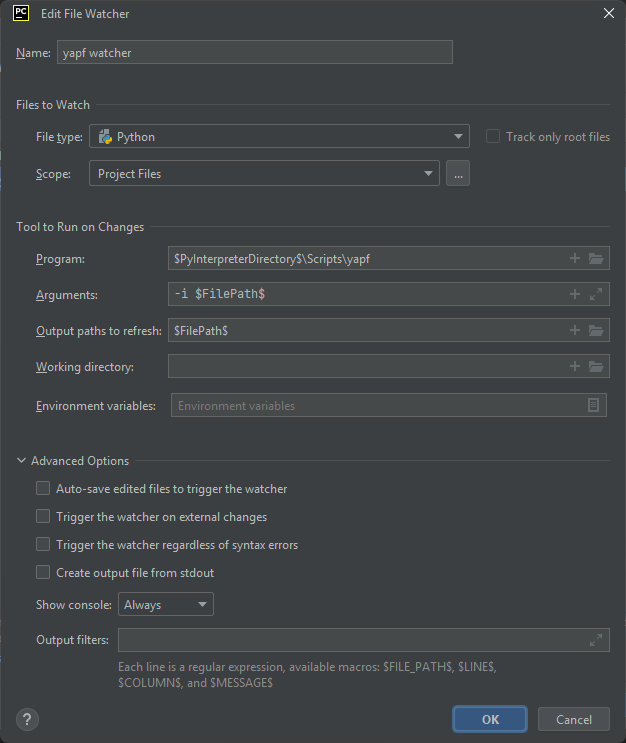
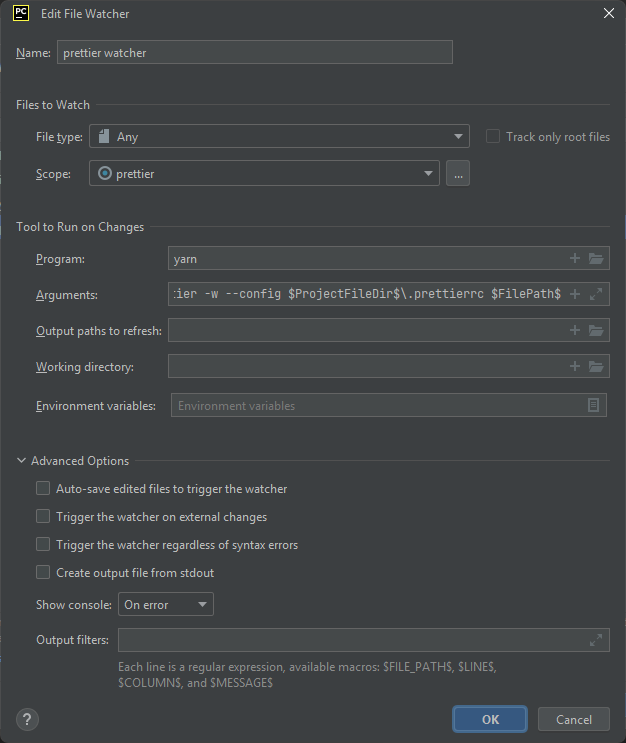

PyCharm 可以配置为在保存时进行格式化和代码检查。这需要一些手动配置，如下所述。

## 设置文件监视器

1. 导航到 File -> Settings -> Plugins
2. 下载并安装 [File Watchers](https://plugins.jetbrains.com/plugin/7177-file-watchers)
3. 导航到 File -> Settings -> Tools -> Black
4. 确认「On code reformat」和「On save」两项下的「Use Black Formatter」均未勾选

## 设置 flake8 监视器

1. 导航到 File -> Settings -> Tools -> File Watchers
2. 点击「+」添加新的监视器。
3. 按下图配置监视器。

   

4. 导航到 File -> Settings -> Editor -> Inspections -> File watcher problems
5. 在 Severity 下选择「Edit Severities」
6. 点击「+」添加一个名为「Linting Error」的严重级别
7. 按下图配置背景和效果。

   

## 设置 isort

1. 导航到 File -> Settings -> Tools -> File Watchers
2. 点击「+」添加新的监视器。
3. 按下图配置监视器。

   

## 设置 yapf

1. 导航到 File -> Settings -> Tools -> File Watchers
2. 点击「+」添加新的监视器。
3. 按下图配置监视器。

   

<!-- prettier-ignore -->
!!! hint
    在列表末尾添加一个逗号会触发 yapf 将列表的每个元素放到新的一行

<!-- prettier-ignore -->
!!! note
    为了调试 vue，必须在启动 django 服务器之前启动 yarn 和 vite 服务器。

## 设置 prettier

1. 导航到 File -> Settings -> Tools -> File Watchers
2. 点击「+」添加新的监视器。
3. 将「File Type」改为「Any」。
4. 点击「Scope」旁边的三个点以创建自定义范围。
5. 点击「+」添加新范围

- 名称：prettier
- 模式：`file:vue/src//*||file:vue3/src//*||file:docs//*`

6. 按下图配置监视器。

   

- 参数：`--cwd $ProjectFileDir$\vue prettier -w --config $ProjectFileDir$\.prettierrc $FilePath$`
