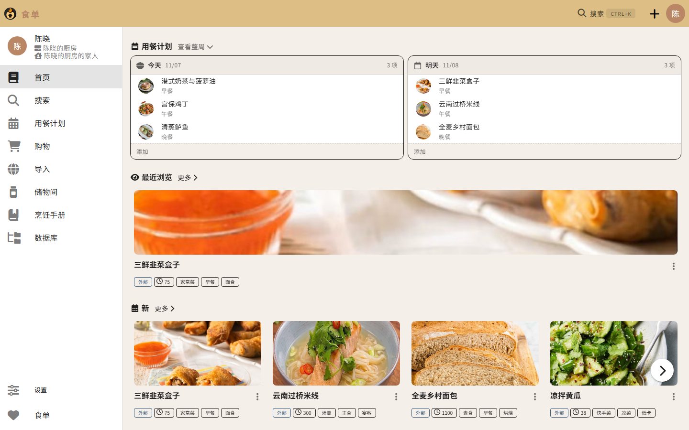

<h1 align="center">
   
  
   
  食单
   
</h1>

<h4 align="center">让您从容管理不断增长的电子菜谱收藏。</h4>

!!! info "关于本页"

    食单基于上游项目 [Tandoor Recipes](https://github.com/TandoorRecipes/recipes) 二次开发，
    本站文档译自上游，功能说明大体适用。品牌、默认语言以及本仓库相对上游的改动，
    以 [改动记录](CHANGES.md) 和 [已知问题](KNOWN_ISSUES.md) 为准；文中提到的 Discord、
    社区与路线图等内容仍指向上游项目。

<a href="install/docker.md">安装</a> •
<a href="CHANGES.md">改动记录</a> •
<a href="KNOWN_ISSUES.md">已知问题</a> •
<a href="screenshots/home.png">界面截图</a> •
<a href="https://github.com/Mryeo1/dishbook">源码</a>

## 核心功能
- 🥗 **管理菜谱**：编辑器快速且直观
- 📆 **安排用餐计划**：为每一天规划多餐
- 🛒 **购物清单**：可由用餐计划生成，也可直接从菜谱生成
- 📚 **菜谱本**：把菜谱整理成册
- 👪 **分享协作**：与亲友共同维护菜谱

## 为进阶用户打造

- 🔍 强大且可定制的**搜索**，支持全文检索与 [TrigramSimilarity](https://docs.djangoproject.com/en/3.0/ref/contrib/postgres/search/#trigram-similarity)
- 🏷️ 创建并搜索**关键词**，可按筛选条件批量分配给匹配的菜谱
- ↔️ 快速**合并**和重命名食材、关键词与单位
- 📥️ 从数千个支持 [ld+json 或 microdata](https://schema.org/Recipe) 的网站**导入菜谱**
- ➗ 支持**分数**与**小数**显示
- 🐳 借助 **Docker** 轻松部署，并提供 **Kubernetes**、**Unraid** 和 **Synology** 的示例配置
- 🎨 用**主题**自定义界面外观
- 📦 与 Dropbox、Nextcloud **同步**文件

## 必备功能一应俱全

- 📱 针对**移动设备**优化
- 🌍 感谢社区贡献，已支持多种**语言**
- 📥️ 从众多其他[菜谱管理器](features/import_export.md)中**导入您的收藏**
- ➕ 还有**菜谱份数缩放、图片压缩、打印视图、超市分类**等更多功能

本应用面向那些希望把菜谱收藏分享给亲友，或只是想井井有条地保存菜谱的用户。系统提供了基础的权限管理，但并不适合作为公开站点对外运行。

## 您的反馈

欢迎分享您使用食单的方式，帮助我改进应用：[Google 问卷](https://forms.gle/qNfLK2tWTeWHe9Qd7)

## 联系我们

<table>
  <tr>
    <td><a href="https://community.tandoor.dev">社区</a></td>
    <td>获取支持、分享最佳实践、讨论功能设想，并结识其他食单用户。</td>
  </tr>

  <tr>
    <td><a href="https://discord.gg/RhzBrfWgtp">Discord</a></td>
    <td>我们有一个任何人都可以加入的公开 Discord 服务器。所有开发者和贡献者都在这里交流，我们也会在此发布公告。</td>
  </tr>
</table>

## 路线图
过去一年里本项目一直处于高速开发之中。在此期间我学到了很多，也加入了大量功能，同时开始使用 Vue.js 等新技术。这带来了许多出色的特性，但在细节和技术实现上，质量仍不能令人满意。

因此，除了在 [Issues & Milestones](https://github.com/vabene1111/recipes/issues) 中持续记录的新功能与新想法之外，未来还有一些更宏观的目标（排名不分先后）：

- 改进界面！目前设计风格不统一，不少页面功能可用但观感欠佳，这一点必须改变。
- 我坚信开放数据与开放系统，因此非常希望为所有相关的菜谱管理系统提供导入器和导出器。
- 把所有 JavaScript 库迁移到包管理器，并清理我早期留下的一些混乱。
- 提升测试覆盖率，同时改进测试用例本身。
- 完善本项目的各项功能与各方面的文档，并在应用内集成帮助。

## 关于
本应用最初是为了索引、标记和检索我自己的电子（PDF）菜谱收藏而开发。随着时间推移，它加入了大量功能，已成为最全面的菜谱管理系统。

我只是一个同时有许多其他兴趣和事务的独立开发者，因此开发和回复有时会比较慢，但我会尽最大努力持续改进这个应用。

如果您有任何愿望、功能需求、问题或想法，欢迎在 GitHub 上提交 issue。
